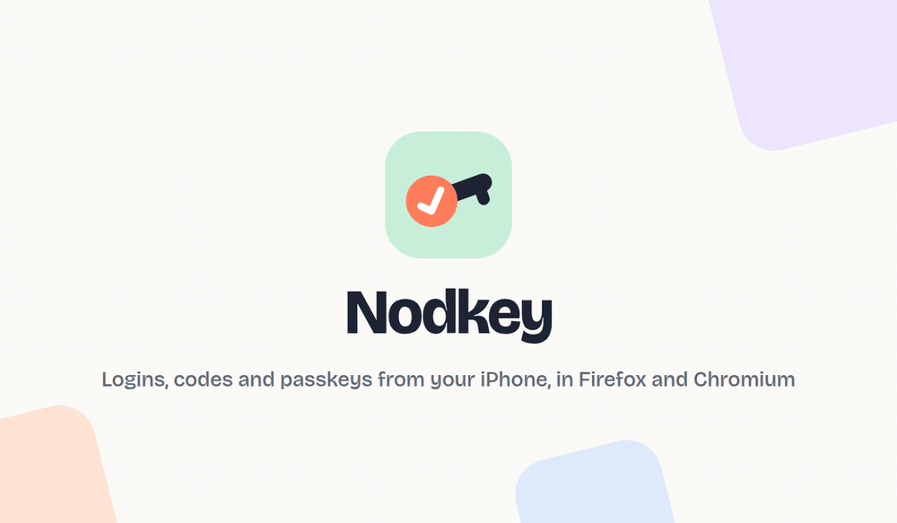
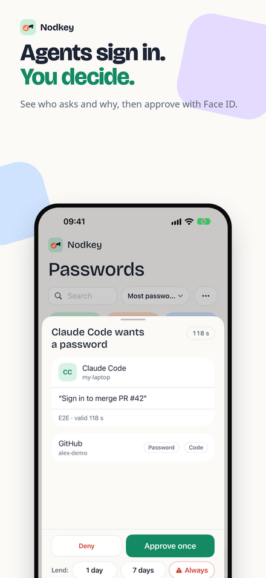
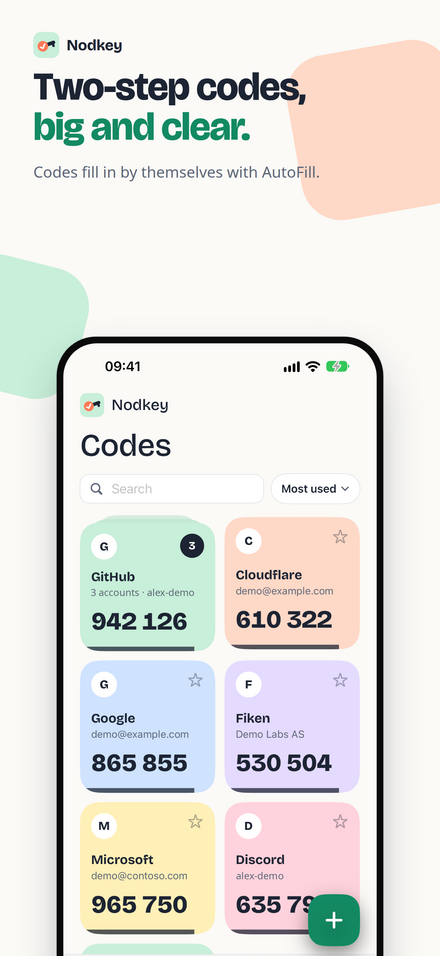
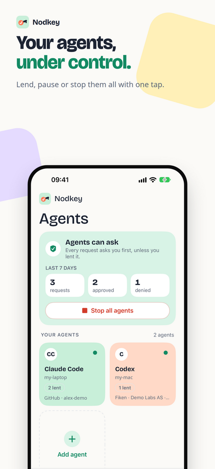

<p align="center">
  
</p>

<h1 align="center">Nodkey for Firefox and Chromium</h1>

<p align="center">
  Sign in with logins, two-step codes and passkeys from your iPhone.<br>
  You approve every request with Face ID.
</p>

<p align="center">
  <a href="https://github.com/peters/nodkey-browser/actions/workflows/ci.yml"></a>
  <a href="LICENSE"></a>
</p>

<p align="center">
  <a href="https://apps.apple.com/app/id6820952672"></a>
</p>

<p align="center">
  
</p>

The Nodkey extension signs you in with logins and one-time codes from
[Nodkey](https://kh-labs.dev/nodkey/) on your iPhone. Every request shows up on
your phone, and nothing leaves it until you approve with Face ID.

## What it does

- **Fill a login.** Click the Nodkey button in a sign-in field, or Fill login in
  the toolbar popup. Approve on your iPhone. The extension fills the user name
  and the password.
- **Fill a code.** The same in a two-step code field, also when the page has one
  box per digit.
- **Codes by SMS.** When a site sends its code by SMS, the Nodkey button in the
  code field can get it from your iPhone. You set this up once with a Shortcuts
  automation on the iPhone.
- **Sign in with Google, Apple and others.** Nodkey knows which sites you sign
  in to with Google, Apple, GitHub, Microsoft or Facebook. It shows you the
  button to click, and it fills your Google (or Apple, ...) login only on that
  provider's own sign-in page. At "Check your phone", the Nodkey button picks a
  passkey or a code from Nodkey instead. After you sign in with a provider, the
  extension can ask to remember it; your iPhone then gets only the site and the
  provider's name.
- **Use passkeys.** When a website asks for a passkey, Nodkey asks your iPhone.
  You approve with Face ID and the iPhone signs. The passkey never leaves your
  iPhone. Websites that use passkeys to unlock a key (the PRF extension) get it
  too. Turn this off in the settings to use the passkeys of the browser.
- **Pay with a card.** In a card field at checkout, click the Nodkey button.
  Nodkey reads the total from the page and shows it. Your iPhone shows the shop
  and the amount, and you approve with Face ID each time. The card is filled in
  only if the total is still the same, and it leaves the fields again if the
  total goes up. Nodkey never clicks Pay. A card you type yourself can be saved
  in Nodkey.
- **Add a card for later.** On a billing page with no total, Nodkey can add your
  card for later payments, without an amount. This also works when the card
  fields come from a payment provider such as Stripe: Nodkey shows the shop
  from the address bar and the provider as "via". You turn this on for the
  browser in Nodkey on your iPhone, and you approve each card with Face ID.
- **See what you approve.** The notification on your iPhone can show a picture
  of the page. It is encrypted so that only your iPhone can see it.
- **Save new passwords.** When you sign up or change a password, the extension
  offers to save it in Nodkey. The password is locked for your iPhone at once:
  the extension never keeps it in readable form.

## How it works

The extension is an agent, like the `nodkey` command line. It pairs once with
your iPhone and shows there with its own name, for example "Firefox on Linux".
Requests go through the Nodkey relay, encrypted end to end. The relay sees no
site, user name, password or code. It sees the IP address that the browser
connects from: it keeps that address and its country with the request, so your
iPhone can show where the request came from, and deletes them with the request
(after 2 minutes, up to 6 for an SMS code).

When you pair, the browser and your iPhone each show a six-digit check number.
You confirm on both that the numbers are the same, so nobody on the way can put
their own keys in between. After that, every request and every answer is signed,
and the extension uses no answer that your iPhone did not sign. Pairing needs a
current version of Nodkey on the iPhone.

The extension's private keys are browser keys that cannot be copied out. The
protocol code is the same Rust code the `nodkey` command line uses, compiled to
WebAssembly.

## Meet Nodkey

<p align="center">
  
  
  
  
</p>

[Nodkey](https://apps.apple.com/app/id6820952672) is a free password manager and authenticator for
iPhone:

- **Passwords, two-step codes and passkeys** behind Face ID, filled in with AutoFill in Safari and
  apps.
- **Agents sign in, you decide.** This extension and coding agents ask; you see who asks, for which
  site and why, and approve with Face ID. Pause one agent, or stop all agents with one tap.
- **Move in in minutes** from Apple Passwords, 1Password, Bitwarden, Chrome, Firefox and more.
  Export everything again at any time.
- **Backed up in your own iCloud**, end-to-end encrypted.
- **No account, no ads, no tracking.** In 12 languages.

## What you need

- An iPhone with iOS 18 or later and [Nodkey](https://apps.apple.com/app/id6820952672)
  from the App Store (free).
- Chromium 137 or later (or a browser built on it), or Firefox 140 or later.

The extension is not in the Chrome Web Store or on addons.mozilla.org yet. Until
then, build it from source (below) and load it unpacked.

## Build

You need Node 24.21 (`.nvmrc`), Rust with the `wasm32-unknown-unknown` target and
`wasm-bindgen-cli` (the version in `Cargo.lock`).

```sh
npm ci
npm run validate
```

This makes `dist/chromium` and `dist/firefox`. Load them as unpacked extensions:

- Chromium: `chrome://extensions`, turn on Developer mode, Load unpacked, pick
  `dist/chromium`.
- Firefox: `about:debugging`, This Firefox, Load Temporary Add-on, pick
  `dist/firefox/manifest.json`.

## Security

The design decisions are in [docs/adr](docs/adr/README.md). To report a security
problem, see [SECURITY.md](SECURITY.md).

## Related

- [nodkey](https://github.com/peters/nodkey-cli): the command line and MCP
  server for coding agents. It holds the protocol
  ([docs/agent-protocol.md](https://github.com/peters/nodkey-cli/blob/main/docs/agent-protocol.md)).
- [kh-labs.dev/nodkey](https://kh-labs.dev/nodkey/): the app's website.

## License

[MIT](LICENSE)
